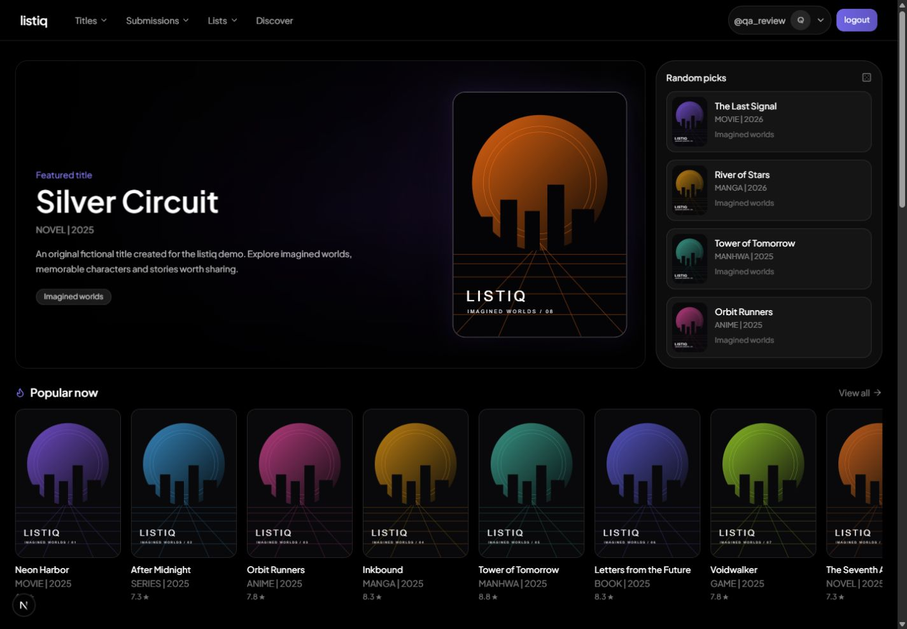

# Listiq

Listiq is a personal tracker for movies, series, anime, manga, games, books, and comics. Browse the catalog, track what you watch, read, or play, and share recommendations through lists and reviews.



- **Library** — track progress, rate titles, and write reviews.
- **Discover** — browse recommendations and save titles to your library or lists.
- **Lists and profiles** — organize titles, share public lists, and choose what appears on your profile.
- **Catalog submissions** — suggest missing titles for moderator review.

The app uses Next.js, TypeScript, React, Prisma, and PostgreSQL. Image uploads use Cloudinary. Hosted catalog sync runs on Vercel Workflow.

## Run locally

Install Node.js 24 and PostgreSQL with `pg_trgm` available. Create an empty development database and give its migration role permission to install the extension.

```sh
npm ci
cp .env.example .env
```

On PowerShell, use `Copy-Item .env.example .env` for the second command. Set `DATABASE_URL` and `DATABASE_URL_UNPOOLED` to the same development database, and replace the `SESSION_SECRET` placeholder with a random secret. To generate one, run `node -e "console.log(require('node:crypto').randomBytes(32).toString('hex'))"`.

```sh
npm run db:generate
npm run db:migrate
npm run dev
```

Open [localhost:3000](http://localhost:3000) and create an account. The database starts with an empty catalog. To import sample titles with a configured `TMDB_ACCESS_TOKEN`, run the command below. See the provider guide for attribution and import limits. [Catalog providers](docs/provider-review.md)

```sh
node --conditions=react-server --import tsx scripts/seedCatalog.ts curated tmdb
```

## Checks

```sh
npm test
npm run typecheck
npm run lint
npm run build
```

`npm run test:integration` requires local PostgreSQL and a role with `CREATEDB`. The runner creates and removes its own test database. [Integration tests](docs/integration-tests.md) · [CI](docs/ci.md)

## Deployment

Use separate PostgreSQL databases and secrets for Preview and Production. Vercel runs `npm run vercel-build`, which generates Prisma Client, applies migrations to the configured database, and builds the app.

The production schedule starts catalog sync daily at 03:00 UTC and checks its health at 07:00 UTC. Configure `CRON_SECRET` for these endpoints and set the Telegram variables in `.env.example` if you want alerts. Cloudinary and provider credentials enable uploads and catalog imports respectively. [Operations guide](docs/operations.md) · [Upload security](docs/upload-security.md)
